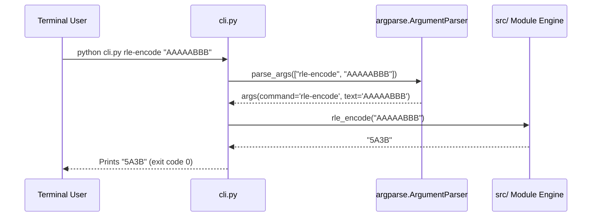

# 🏛️ Architecture & System Design Document

## Project: `DevToolkit`
**Version:** 1.4.0  
**Architectural Style:** Modular Monolith / Zero-Dependency Component Library  
**Runtime:** Python 3.8+ Standard Library  

---

## 1. High-Level Architectural Overview

`DevToolkit` is architected as a **purely decoupled, zero-dependency utility suite**. Every module inside [`src/`](file:///d:/ASHISH%20GITHUB/test-repo/src/) operates independently or references only foundational sibling modules (such as type definitions or basic math helpers).

```mermaid
graph TD
    subgraph Client Application / Developer
        A[Python Application Code] -->|import| B[src/ Module Layer]
        C[Terminal / Shell CLI] -->|execute| D[cli.py Entrypoint]
    end

    subgraph DevToolkit Core Engine
        D -->|dispatch| B
        B --> E[CS Data Structures]
        B --> F[Graph & Tree Algorithms]
        B --> G[Text, Hashing & Compression]
        B --> H[Resilience & Concurrency]
        B --> I[Security & Authentication]
        B --> J[Math, Coordinates & Colors]
    end

    subgraph Standard Library Foundation (0 External Deps)
        E --> K[collections, heapq, bisect, struct]
        F --> K
        G --> L[hashlib, hmac, re, difflib]
        H --> M[threading, time, asyncio]
        I --> N[secrets, base64, math]
        J --> N
    end

    subgraph Quality Assurance & Packaging
        O[tests/ Test Suite] -->|100% verification| B
        P[pyproject.toml PEP 621] -->|packaging & distribution| B
        Q[GitHub Actions CI Matrix] -->|automated testing| O
    end
```

---

## 2. Directory & Component Layout

```
test-repo/
├── .github/
│   ├── workflows/test.yml           # GitHub Actions Multi-Python CI Matrix (3.8 - 3.12)
│   └── ISSUE_TEMPLATE/              # Bug reports & feature request templates
├── src/                             # 115+ pure zero-dependency Python modules
│   ├── __init__.py                  # Package exports & metadata
│   ├── astar_search.py              # A* 2D Grid pathfinding
│   ├── base62_utils.py              # Base62 compacting
│   ├── bit_field.py                 # Struct-like bitfield packing
│   ├── bloom_filter_scalable.py     # Tightened dynamic Bloom filter
│   ├── circuit_breaker.py           # Fault tolerance circuit trip
│   ├── consistent_hash_ring.py      # Virtual-node consistent hashing
│   ├── cron_parser.py               # 5-field cron parser & explainer
│   ├── fenwick_tree.py              # Binary Indexed Tree (BIT)
│   ├── hungarian_algorithm.py       # Kuhn-Munkres linear assignment
│   ├── kd_tree.py                   # k-dimensional spatial tree
│   ├── lfu_cache.py                 # O(1) LFU cache
│   ├── rate_limiter.py              # Token Bucket rate limiter
│   ├── rle_compression.py           # Run-length text & byte encoding
│   ├── segment_tree.py              # Associative range query tree
│   ├── tarjan_scc.py                # Strongly connected components
│   ├── totp_utils.py                # RFC 6238 TOTP / RFC 4226 HOTP
│   └── ... (115+ specialized modules)
├── tests/                           # 120+ unit test files (343+ test cases)
│   ├── test_astar_search.py
│   ├── test_bloom_filter_scalable.py
│   ├── test_cli_commands_v5.py
│   └── ...
├── cli.py                           # Unified CLI dispatcher (37+ subcommands)
├── pyproject.toml                   # PEP 621 build configuration
├── README.md                        # Primary developer documentation & badges
├── PRD.md                           # Product Requirements Document
├── ARCHITECTURE.md                  # System Architecture Specification
├── DESIGN.md                        # Algorithmic & API Design Patterns
├── MEMORY.md                        # Repository technical memory & decisions
├── RULES.md                         # Engineering standards & constraints
└── TRACKER.md                       # Feature inventory & test coverage tracker
```

---

## 3. Core Architectural Subsystems

### 3.1 Advanced Data Structures Layer
* **Separation of Concerns:** Each data structure is implemented as a standalone generic class (`Generic[K, V]` or `Generic[T]`).
* **Memory Optimization:** Uses primitive arrays (`bytearray`, `list`, `collections.OrderedDict`) to minimize Python object pointer overhead.
* **Deterministic Scaling:** Scalable structures (such as `ScalableBloomFilter`) calculate required bit size $m = - \frac{n \ln p}{(\ln 2)^2}$ and hash count $k = \frac{m}{n} \ln 2$ on instantiation.

### 3.2 Graph & Pathfinding Layer
* **Node Agnostic:** Accepts arbitrary node representations (strings, ints, or custom hashable objects).
* **Sparse Graph Friendly:** Adjacency lists and edge-tuple representations ensure minimal memory footprint on massive sparse networks.

### 3.3 Security & Cryptographic Simulation Layer
* **Safe Secrets:** Uses `secrets.token_bytes()` for all cryptographically secure randomness.
* **Pure Hashlib Pipelines:** Leverages C-backed stdlib `hashlib.sha256`, `hmac.new`, and `hashlib.pbkdf2_hmac` for maximum throughput without OpenSSL bindings.

### 3.4 CLI Subcommand Dispatch Pipeline
The CLI architecture uses a **two-phase argument parsing pipeline**:
1. **Command Registration:** Subparsers declare required arguments, positional flags, and type conversions via `argparse`.
2. **Dispatch Handler:** Dispatches parsed options directly into the target module function, returning human-formatted output to `stdout` with ANSI color formatting.



---

## 4. Architectural Constraints & Non-Negotiables

1. **Zero External Dependencies:** No package outside the Python Standard Library may ever be imported into `src/`.
2. **Python 3.8 Compatibility:** Modern language features must maintain backward compatibility down to Python 3.8 (e.g. use `typing.List`, `typing.Optional`, `typing.Dict`, avoiding bare `list[int]` where syntax errors occur in 3.8).
3. **No Global State / Thread Safety:** Cache and rate-limiting modules must encapsulate state within instance variables rather than global module variables.
4. **Deterministic Exit Codes:** CLI commands must return `0` on operational success and `1` on invalid arguments or runtime errors.
